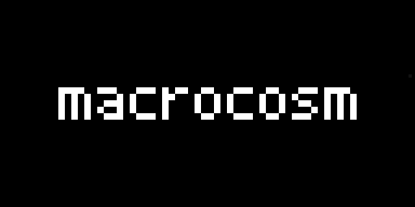
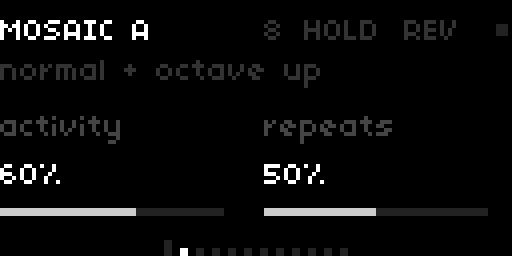
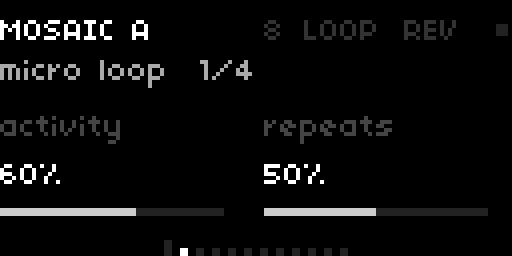
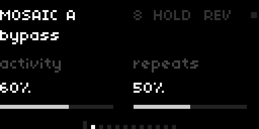
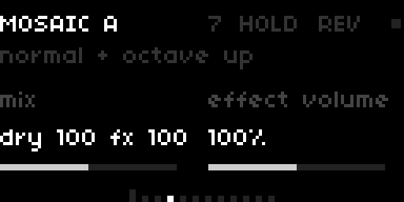
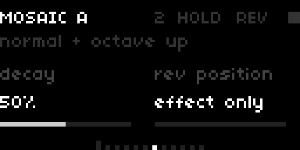
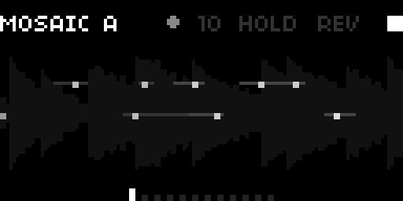
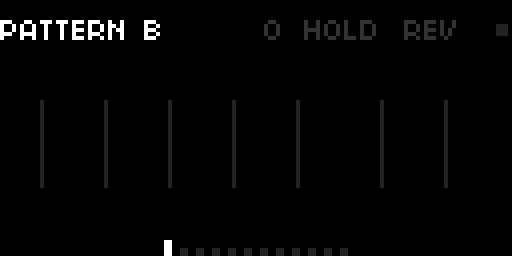
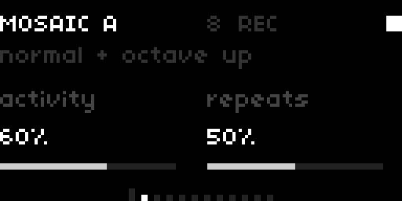

# macrocosm



**A granular micro-looper for norns, inspired by the Hologram Electronics Microcosm.**

macrocosm listens to what you play and turns it into loops, grain clouds, rhythmic delays and glitches: 11 effects in 4 families, each with its own variations. A filter, six reverbs and a modulation section shape the effect, and a phrase looper sits at the end of the chain. It is MIDI-controllable, and its parameters can be modulated with `matrix` and `toolkit`.

It is written from scratch in SuperCollider and Lua. macrocosm is not affiliated with Hologram Electronics.

---

## Requirements

- norns. Developed and tested on a norns shield (Raspberry Pi 4). Not tested yet on a Pi 3 or a standard norns.
- CPU, measured on a Pi 4 (SuperCollider DSP load, norns included): 25–27 % for Strum, Arp, Blocks, Interrupt and Seq, about 31 % for Glide and Tunnel, 35–36 % for Pattern and Warp, and from 30 % up to 38 % for Mosaic and Haze as Activity and Repeats go up.
- Audio input: a guitar or any other instrument. Mono (left input) by default. Switch to stereo in PARAMETERS.
- Optional: a MIDI controller, and the `matrix` and `toolkit` mods.

## Install

From maiden:

```
;install https://github.com/CyberDuck79/macrocosm
```

Then **SYSTEM > RESTART** so that norns compiles the new engine, and load **macrocosm** from SELECT.

---

## Quick start

1. Plug in your instrument and play. You hear your dry signal plus **Mosaic A**: loops of what you just played, at normal speed and an octave up.
2. **Hold K1 and turn E2** to change effect, and **E3** for the variation. **E1** jumps between the four families.
3. Turn **E2 / E3** to set **Activity** and **Repeats**. **E1** goes through the other pages.
4. **K2** freezes the sound (Hold). **K3** plays the effect backwards (Reverse).
5. **K1 + K2** opens the looper. Then **K2** records, plays and overdubs, and **K3** stops.

A short animation plays at launch. Any key or encoder skips it, and the sound is already running underneath.

---

## The screen



- **Top line:** effect and variation, attack indicator (a dot that flashes on each note it detects), number of active voices, what **K2** and **K3** do right now, and the clock.
- **Clock:** a square that flashes on each beat of the norns clock. It is bigger on the first beat of the bar.
- **Second line:** what the current variation does, or `bypass` when bypass is engaged.
- **Two settings:** **E2** on the left, **E3** on the right, with their bars.
- **Bottom:** the page indicator.

Labels are dim when idle, bright when active, and blink while something is in progress (for example, looper recording).

## Controls

| Control | Action |
|---|---|
| E1 | change page |
| E2 / E3 | the two settings of the page |
| K2 | Hold on / off |
| K3 | Reverse on / off |
| K1 held + E1 | change family |
| K1 held + E2 | change effect within the family |
| K1 held + E3 | change variation |
| K1 + K2 | enter / leave the looper |
| K1 + K3 | Reverse (also inside the looper) |



While K1 is held, the second line shows the family and its number (for example `micro loop  1/4`).

## Pages

| Page | E2 | E3 |
|---|---|---|
| 0 | Engine View | |
| 1 | **Activity** | **Repeats** |
| 2 | **Shape** | **Time** |
| 3 | **Mix** | **Effect volume** |
| 4 | **Filter** | **Resonance** |
| 5 | **Space** | **Reverb** mode |
| 6 | **Character** | **Rev position** |
| 7 | **Mod depth** | **Mod rate** |
| 8 | **Drift** | **Lo-fi** |
| 9 | **Loop level** | **Loop speed** |
| 10 | **Loop reverse** | **Rec start** |
| 11 | **Tempo** | **Attack sens** |

The script starts on page 1. Page 0, to its left, is the Engine View. The pages follow the signal path: effect, dosage, tone, reverb, colour, looper, then the settings you set once before playing.

---

## Effects

Everything an effect plays comes from a buffer that records your input all the time, about 21 seconds long.

**Activity**, **Repeats** and **Shape** change meaning with each effect. In short: **Activity** is how much happens, **Repeats** is how long things last, and **Shape** is the volume envelope (or the curve) of each voice. **Time** sets the rhythmic unit the effect is built on.

Changing effect keeps the variation letter when it exists. Otherwise it goes to the last variation available.

### Micro loop: short loops of what you just played

**MOSAIC**: overlapping loops at several speeds. Activity = number of loops, Repeats = how long they last.

| | |
|---|---|
| A | normal + octave up |
| B | normal + octave down |
| C | all at double speed |
| D | half to quad speed |
| E | forward and reversed, x1 and x2 |
| F | half to quad, some reversed |

**SEQ**: an 8-step phrase is captured, then played back shuffled. Repeats = how many cycles before a new phrase is captured. What Activity does depends on the variation.

| | |
|---|---|
| A | filtered, shuffled rhythms |
| B | normal and half speed |
| C | layers with filter sweeps |
| D | crushed interlocking layers |

**GLIDE**: loops whose pitch glides between two speeds. Activity = glide speed, Shape = shape of the glide (falling ramp, triangle, rising ramp), Repeats = how long the loops last. From E to H, each loop glides only once, in one direction.

| | |
|---|---|
| A | between half and normal |
| B | between double and half |
| C | between normal and double |
| D | both directions at once |
| E | one glide up from half |
| F | one glide down from double |
| G | one glide up to double |
| H | random one-way glides |

### Granules: clouds of grains and drones

**HAZE**: clouds of grains that turn into a pad. Activity = grain density and spread, Repeats = grain length.

| | |
|---|---|
| A | short, stretched and diffused |
| B | many randomized grains |
| C | normal and double speed |
| D | normal and half speed |
| E | mostly reversed, detuned |

**TUNNEL**: each new note becomes a drone looped on its sustain. Activity = depth of each variation's modifier, Repeats = how long the drone takes to fade.

| | |
|---|---|
| A | loop length breathes |
| B | sub-octave, filter sweeps |
| C | resonant band-pass drones |
| D | playing squeezes the loop |
| E | filter breathes slowly |
| F | drones with octave-up layer |

**STRUM**: each attack starts a rhythmic chain of repeats. Activity = density of the pattern, Repeats = length of the chain.

| | |
|---|---|
| A | repeats the latest note |
| B | overlapping copies, phasing |
| C | cascade of recent notes |
| D | cascade with octave-up grains |

### Multidelay: a delay with up to 8 taps

Activity = number of taps (1 to 8), Repeats = feedback, Shape = level slope across the taps, Time = unit of the pattern. Hold repeats forever.

**PATTERN**: the taps form rhythmic patterns.

| | |
|---|---|
| A | straight, classic delay |
| B | syncopated taps |
| C | clustered taps |
| D | triplet taps |

**WARP**: each tap is filtered or transposed.

| | |
|---|---|
| A | envelope filter on each tap |
| B | resonant band-pass taps |
| C | pitch-shifted taps |
| D | taps fade into octave grains |

### Glitch: what you play, cut up

**BLOCKS**: recent playing rearranged into repeated blocks. Activity = how much is manipulated, Repeats = repeats per block.

| | |
|---|---|
| A | rearranged, bursts of runs |
| B | rearranged and pitch-shifted |
| C | soft, filtered, overlapping |
| D | pitch-shifted and crushed |

**INTERRUPT**: bursts that cut into your live playing. Activity = how much is manipulated, Repeats = how often it interrupts. With Mix at "fx only", the dry signal is really cut during the bursts.

| | |
|---|---|
| A | rearranged interruptions |
| B | pitch-shifted interruptions |
| C | filter sweeps and delay |
| D | crushed, drastic glitches |

**ARP**: your last notes turned into an arpeggio. Activity = number of steps, Repeats = step speed.

| | |
|---|---|
| A | arpeggio of recent notes |
| B | pitch-shifted pattern |
| C | random filter on each step |
| D | crushed arpeggios |

---

## Hold, Reverse, Bypass, Tap

- **Hold** (K2): freezes the buffer. The effect keeps playing what was there, and new playing is not recorded. With a multidelay, the repeats go on forever.
- **Reverse** (K3, or K1 + K3): the effect plays backwards.
- **Bypass** (parameter or MIDI CC 102): the clean input passes through; effect, reverb and looper are cut, without tails. `bypass` is shown on screen. There is no key for it.
- **Tap tempo** (parameter or MIDI CC 93): the average of the last 4 taps. It resets after 2 seconds without a tap, and does nothing when the clock is external.



## Time and clock

macrocosm follows the norns clock (PARAMETERS > CLOCK: internal, MIDI, Link…). **Tempo** is on page 11.

**Time** (page 2) sets the unit, from the longest to the shortest: `1 bar`, `1/2`, `1/4D`, `1/4` (default), `1/4T`, `1/8`, `1/8T`, `1/16`, `1/16T`, `1/32`. Set **time mode** to *free* in PARAMETERS, and page 2 sets a fixed duration from 50 ms to 2 s, independent of tempo.

Voices locked to the grid start exactly on time. Voices triggered by an attack (Strum, Arp, Tunnel) start 25 ms after the attack is detected.

## Mix and filter



- **Mix**: at the centre, both dry and effect are at full level. Turning left lowers the effect, down to *dry only*; turning right lowers the dry, down to *fx only*.
- **Effect volume**: level of the effect alone, up to 200 %.
- **Filter**: centre is open. Left is a low-pass (fully left cuts the effect), right is a high-pass up to 6 kHz. **Resonance** works on both sides. Only the effect is filtered.

## Reverb



**Space** sets the amount and **Reverb** the mode. **Character** changes one thing per mode. At 50 % it gives the standard sound of that mode, and its name changes with the mode:

| Mode | Character | What it changes |
|---|---|---|
| bright room | air | damping of the highs |
| dark medium | warmth | damping of the highs, darker |
| large hall | decay | decay time, 2 to 10 s |
| ambient | movement | depth and speed of the tail modulation |
| shimmer | sparkle | amount of octave-up in the tail |
| cathedral | bloom | pre-delay, then a slow build-up of early echoes |

**Rev position**: *effect only* (default), *after mix* (dry and effect), or *before fx* (the reverb is applied to the input, so the effect plays a reverberated sound). Changing mode or position while playing does not click.

## Colour

- **Mod depth / Mod rate**: pitch modulation of the effect.
- **Drift**: wow, flutter and slow random drift, tape-style.
- **Lo-fi**: lower sample rate and bit depth, soft saturation. Above 50 % (`slow`), the voices also slow down, down to half speed at 100 %.
- **drift/lo-fi on** (PARAMETERS): *effect* (default) or *all* (dry, effect and reverb together).

## Engine View



Page 0 shows what the engine is doing. Time runs from right (now) to left (4 seconds ago), and height is speed: the centre is normal speed, the edges are ±2 octaves. Each voice is a dot. Brighter means louder, a hollow dot is reversed, and a line is a looping segment. The background shows the input level.



With Pattern and Warp, each tap is a vertical bar at its delay time. It lights up when your playing passes through it.

On this page, E2 and E3 still set Activity and Repeats.

---

## Looper



**K1 + K2** enters the looper. K2 and K3 then control it, and the top line always says what they will do:

| State | K2 | K3 |
|---|---|---|
| empty | **REC** start recording | |
| armed (rec start) | `ARM` + beats left | **STOP** cancel |
| recording | **REC** blinking, press to close the loop | **STOP** close and stop |
| playing | **DUB** start overdub | **STOP** |
| overdubbing | **DUB** blinking, press to stop overdub | **STOP** |
| stopped | **PLAY** | **CLR** erase |

- **K2 held** (0.6 s) while playing or overdubbing: **UNDO** removes the last overdub.
- **K3 held** (0.6 s): erases the loop, whatever its state.
- **K1 + K2** leaves the looper. The loop keeps playing, and a thin line under the effect name shows its position.
- Hold is not available while the looper is open.

On the pages: **Loop level** (up to 150 %) and **Loop speed** (`1/4`, `1/2`, `1`, `2`, `4`) on page 9, **Loop reverse** and **Rec start** on page 10.

### Playing without a pedal

On norns your hands are on the instrument, so the looper can wait for you. All of these are in PARAMETERS > looper:

- **rec start**: *now*, *next bar* (K2 arms, recording starts on the next bar), or *count-in* (at least one full bar of count-in).
- **rec length**: *free*, or 1, 2, 4, 8 bars. The loop closes by itself, at an exact length, and starts playing.
- **quantize**: *off*, *beat* or *bar*. The loop length is rounded to the nearest beat or bar.
- **metronome**: *off*, *count-in* (default) or *always*, and **click level**. The click is never recorded.
- **beats per bar**: 4 by default.

With *count-in* and a fixed *rec length*, you press K2 once and play.

### Other looper settings

- **order**: *rec > play > dub* (default) or *rec > dub > play*: what K2 does after recording.
- **burst**: the loop records only while K2 is held.
- **routing**: *post-fx* (default: records the full output) or *pre-fx* (records the input, and the loop plays back into the effect).
- **looper only**: the effect is muted; you hear the dry signal and the loop.
- **loop fade**, **fade**: fades when the loop stops and starts again.
- **loop seam**: crossfade at the loop point (80 ms by default), so a sustained note does not click when the loop restarts.

Loops last up to 60 seconds.

---

## Presets

Use the norns PSET menu. A preset saves every setting and **the loop itself** (as two WAV files next to the preset). Loading the preset brings the loop back, stopped; K2 plays it. Deleting the preset deletes its loop.

At launch, macrocosm loads the last preset you saved or loaded. With no preset, it starts with the default settings.

---

## MIDI

PARAMETERS > midi: **midi control** (on), **midi port** (all), **midi channel** (1). These three are not saved in presets.

The MIDI clock is handled by norns (PARAMETERS > CLOCK). PARAMETERS > MAP is still available for other settings. Avoid mapping a CC that is already in the table below, or it will act twice.

### Control Change

| CC | Function | CC | Function |
|---|---|---|---|
| 5 | Time, 6 steps (1 bar … 1/32) | 22 | Looper open / closed (≥ 64) |
| 6 | Activity | 23 | Loop reverse |
| 7 | Shape | 24 | Routing |
| 8 | Filter | 25 | Looper only |
| 9 | Mix | 26 | Burst |
| 10 | Time, all 10 values (or free time) | 27 | Quantize |
| 11 | Repeats | 28 / 29 / 30 | Rec / Play / Overdub |
| 12 | Space | 31 / 34 / 35 | Stop / Erase / Undo |
| 13 | Loop level | 46 | Save preset (value = preset 1–16) |
| 14 | Mod rate | 47 | Reverse (toggle) |
| 15 | Resonance | 48 | Hold (≥ 64) |
| 16 | Effect volume | 93 | Tap tempo |
| 17 | Loop speed, continuous | 102 | Bypass (0–63 bypassed, 64–127 on) |
| 18 | Loop speed, steps | | |
| 19 | Mod depth | | |
| 20 | Character | | |
| 21 | Loop fade | | |

Switches (23–27) are off below 64 and on from 64. Actions (28–35, 47, 93) fire on any non-zero value, so the 0 a button sends when released is ignored.

### Program Change

Numbered from 1 (some devices show them from 0: subtract 1).

| Program | Selects |
|---|---|
| 1–4 | Arp A–D |
| 5–8 | Interrupt A–D |
| 9–12 | Blocks A–D |
| 13–16 | Glide A–D |
| 17–20 | Seq A–D |
| 21–24 | Mosaic A–D |
| 25–28 | Haze A–D |
| 29–32 | Tunnel A–D |
| 33–36 | Strum A–D |
| 37–40 | Pattern A–D |
| 41–44 | Warp A–D |
| 45–60 | load preset 1–16 |
| 61–64 | Glide E–H |
| 65–66 | Mosaic E–F |
| 67 | Haze E |
| 68–69 | Tunnel E–F |

The CC and Program Change layout follows the Microcosm's MIDI chart, so a setup made for the pedal mostly works as is. Differences: CC 7 is continuous, CC 18 stops at 4x, CC 20 sets Character, CC 45 (copy preset) does nothing, and there is no MIDI thru.

---

## Modulation with matrix and toolkit

With the `matrix` mod enabled (SYSTEM > MODS, then restart), every continuous setting can be modulated, and so can **Variation**, **Time**, **Hold**, **Reverse**, **Bypass** and **Loop speed**. `toolkit` adds LFOs, sequences, rhythms and macros as sources. Nothing to set up in macrocosm itself.

**Effect** and **Reverb** mode are lists, which `matrix` does not modulate. Use MIDI Program Change or a preset to switch them.

---

## Parameters menu

Everything above is also in PARAMETERS, under three sections:

- **macrocosm**: input (mono / stereo), effect and all its settings, time mode, reverb, colour, attack sens, hold, reverse, bypass, tap tempo.
- **looper**: all looper settings, metronome and beats per bar.
- **midi**: control, port, channel.

**attack sens** (page 11) sets how easily a note is detected. Raise it if Strum, Arp or Tunnel miss soft notes, lower it if they react to noise.

---

## Differences from the Microcosm

macrocosm is its own instrument, not an emulation. Some things work differently:

- The effects follow the Microcosm's descriptions, but the sound is not a copy.
- Some effects have extra variations (letters after D).
- More TIME values (triplets, dotted quarter, free time), a bipolar filter, two extra reverbs, Character and reverb position, Drift and Lo-fi, the Engine View.
- In *looper only*, the loop does not go through the filter and reverb.
- Loop speed is in steps (`1/4` to `4`). Overdub at a speed other than 1 is approximate.
- With quantize, the effect does not restart with the recording.
- Bypass has no key and no trails mode.

---

## Credits

- Inspired by the **Hologram Electronics Microcosm**. macrocosm is not affiliated with or endorsed by Hologram Electronics.
- Thanks to **Tessera** (rechandler) for its reading of the Microcosm, used as a reference.
- Reverb: **JPverb** from sc3-plugins.

License: GPL-3.0. See `LICENSE` in the repository.
